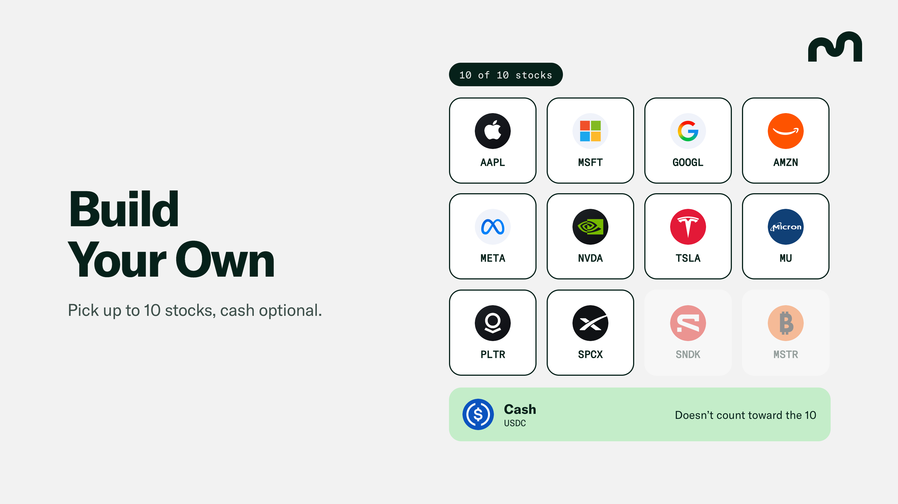

# 📈 Stocks

<figure><figcaption></figcaption></figure>

## What is Mamo Stocks?

Mamo Stocks lets you build a portfolio of [tokenized stocks](https://www.coinbase.com/en-au/tokenize) on [Base](https://www.base.org/), with automated rebalancing to maintain your chosen allocation. You select your stocks, set a target percentage for each, and deposit [USDC](https://www.usdc.com/). Mamo then buys and sells holdings according to your portfolio settings.

Rebalancing means adjusting your holdings to keep your portfolio aligned with your chosen mix. As prices change, some stocks represent a larger share of your portfolio and others a smaller share. Mamo can sell holdings above their targets and use the proceeds to buy holdings below their targets.

Unlike Mamo’s USDC, Bitcoin, and Ethereum accounts, Mamo Stocks does not earn a savings rate. Your portfolio’s value changes with the prices of the stocks you hold, less fees and trading costs. Automated rebalancing helps maintain your chosen allocation, but does not protect against losses.

Each stock is represented by a token issued by [Coinbase](https://www.coinbase.com/en-gb) on Base, such as AAPLc for Apple or NVDAc for Nvidia. Each token is backed 1:1 by a share held by a regulated custodian. These tokens can trade around the clock, including weekends, although Mamo applies additional restrictions to automated trading outside U.S. stock market hours.

<figure><figcaption></figcaption></figure>

***

## How it works

### 1. Build your portfolio

<figure><figcaption></figcaption></figure>

Choose up to ten supported stocks and assign a target percentage to each. Every stock must have a target allocation of at least 5%.

You can also allocate part of your portfolio to USDC as cash. Cash is optional and does not count toward the ten-stock limit. Your stock and cash allocations must total 100%.

For example:

| Holding   | Target allocation |
| --------- | ----------------- |
| Apple     | 40%               |
| Nvidia    | 40%               |
| USDC cash | 20%               |

### 2. Deposit USDC

The minimum deposit is 100 USDC. Mamo uses your deposit to purchase stocks according to your target allocations. With a deposit of 1,000 USDC and the allocation above, Mamo would purchase 400 USDC of Apple and 400 USDC of Nvidia, leaving 200 USDC as cash, before trading costs.

If the U.S. stock market is closed, your deposit remains in USDC until the market opens and Mamo can purchase stocks.

### 3. Automated rebalancing

<figure><figcaption></figcaption></figure>

As stock prices change, the percentage of your portfolio held in each stock changes too. For example, a stock with a 40% target allocation may grow to represent more than 40% of your portfolio if its price rises. Rebalancing brings these allocations back toward your targets. It follows your portfolio settings rather than a price rise or decline alone.

Mamo monitors each holding against its target, with a tolerance of five percentage points above or below it. For a 40% target, the permitted range is 35% to 45%.

When all holdings remain within their ranges, Mamo does not rebalance. When a holding moves outside its range, Mamo can sell a holding above its target and use the proceeds to buy one below its target. These adjustments are subject to trading checks and minimum trade sizes.

**Rebalancing example**

Suppose Nvidia rises by 30%, while Apple’s price remains unchanged. Your portfolio would be:

| **Holding** | **Value**      | **Allocation** |
| ----------- | -------------- | -------------- |
| Apple       | 400 USDC       | 35.7%          |
| Nvidia      | 520 USDC       | 46.4%          |
| USDC cash   | 200 USDC       | 17.9%          |
| **Total**   | **1,120 USDC** | **100%**       |

Nvidia is now 6.4 percentage points above its 40% target, putting it outside the permitted range.

Mamo identifies the holdings furthest above and below their targets. In this example, Mamo sells approximately 48 USDC of Nvidia and uses the proceeds to buy Apple.

Ignoring trading costs, the portfolio becomes:

| **Holding** | **Value**      | **Allocation** |
| ----------- | -------------- | -------------- |
| Apple       | 448 USDC       | 40.0%          |
| Nvidia      | 472 USDC       | 42.1%          |
| USDC cash   | 200 USDC       | 17.9%          |
| **Total**   | **1,120 USDC** | **100%**       |

All holdings are now within their permitted ranges. Rebalancing does not need to return every holding to its exact target.&#x20;

Mamo trades one pair of holdings at a time and may perform additional trades when multiple holdings require adjustment. Cash is included in this process: Mamo can use excess cash to purchase stocks or sell stocks to replenish cash.

<figure><figcaption></figcaption></figure>

### 4. Add funds

You can deposit additional USDC at any time. Mamo directs new funds toward holdings that are furthest below their targets, helping bring the portfolio closer to your chosen allocation.

Purchases remain subject to market-hours restrictions and trading checks.

### 5. Update your portfolio

You can add or remove stocks and adjust your target allocations at any time. Mamo then trades toward your updated settings, subject to the same trading checks.

When you remove a stock, Mamo sells the holding and reallocates the proceeds according to your revised portfolio settings.

***

## Supported stocks

Mamo Stocks supports the following tokenized stocks on Base. You can include up to ten in your portfolio, alongside an optional allocation to USDC cash.

| **Company** | **Token** |
| ----------- | --------- |
| Apple       | AAPLc     |
| Amazon      | AMZNc     |
| Alphabet    | GOOGLc    |
| Meta        | METAc     |
| Microsoft   | MSFTc     |
| Strategy    | MSTRc     |
| Micron      | MUc       |
| Nvidia      | NVDAc     |
| Palantir    | PLTRc     |
| SanDisk     | SNDKc     |
| SpaceX      | SPCXc     |
| Tesla       | TSLAc     |

The supported list may change over time. Refer to the app for current availability.

## Portfolio value and returns

Your portfolio is valued in USDC using the current prices of your stock holdings, plus any USDC held as cash.&#x20;

Mamo Stocks does not pay interest or distribute any additional rewards. Your returns depend on changes in the value of your holdings, less the annual management fee and trading costs. Your portfolio can lose value.

***

## Trade execution

Mamo routes portfolio rebalances through [CoW Protocol](https://cow.fi/) and executes stock sales on [Aero](https://aero.xyz/) on Base. Trades remain subject to your account’s pricing, allocation, and supported-holding checks.

### Small trades and allocation differences

Mamo skips trades below its minimum trade size. As a result, a holding may remain outside its permitted range until a larger adjustment can be made.&#x20;

This is more noticeable in smaller portfolios, particularly those close to the 100 USDC minimum, and may occur after adding a stock or when cash is slightly above target.

Further price movements, additional deposits, or changes to your portfolio settings may make an adjustment large enough to execute.

### Trading safeguards

Mamo proposes trades, and your account checks each trade before it settles. Trades that do not meet the account’s rules are rejected.

The checks include:

* **Price limits.** Each rebalance must execute at a price no more than 1% worse than the reference price. The reference uses the stock’s recent average price on [Aero](https://aero.xyz/) rather than a single quote, helping reduce the influence of short-lived price movements.
* **Allocation limits.** After a rebalance trade, both holdings involved must be within five percentage points of their targets.
* **Selected holdings only.** Mamo can only purchase stocks included in your portfolio.

### Trading outside U.S. market hours

When the U.S. stock market is closed, Mamo does not make automated stock purchases. New deposits remain in USDC until the market reopens.

During these hours, Mamo will only sell a stock toward its target allocation if its price is higher than its price at the previous market close.

These restrictions limit automated trading during periods when liquidity may be lower and token prices may diverge from the underlying share prices.

***

## Fees and limits

Mamo Stocks charges an annual management fee of 1% of your portfolio’s value, accrued throughout the year rather than charged per trade.

| Item                                | Fee or limit          |
| ----------------------------------- | --------------------- |
| Annual management fee               | 1% of portfolio value |
| Deposit fee                         | None                  |
| Withdrawal fee                      | None                  |
| Minimum deposit                     | 100 USDC              |
| Maximum stock holdings              | 10                    |
| Minimum target allocation per stock | 5%                    |

Trading costs may apply when stocks are bought or sold, including during deposits, rebalancing, and withdrawals.&#x20;

Any net deposit cap is calculated as total USDC deposited minus withdrawals. Portfolio gains do not count toward this cap.

## Security and control

Mamo Stocks uses a personal, non-custodial account owned by you. Only you can withdraw funds, change your portfolio settings, or approve an account upgrade.

Mamo’s role is limited to proposing trades that pass your account’s checks. It cannot withdraw your funds. You can turn off automated trading at any time. Doing so does not disable withdrawals.

### Withdrawals

There are no lockups or scheduled withdrawal periods. You can request a withdrawal at any time, including outside U.S. stock market hours, subject to network availability, token transfer restrictions, and any checks required for the withdrawal method.

You can withdraw in two ways:

#### Withdraw as USDC

Mamo sells the stock holdings needed to fund your withdrawal and sends USDC to your wallet.

Execution depends on available liquidity and pricing checks. Large withdrawals or withdrawals during periods of low liquidity may receive less favourable prices or fail to execute.

#### Withdraw stock tokens and USDC

An in-kind withdrawal transfers your stock tokens and any USDC directly to your wallet without selling them. This avoids the need to execute stock trades and does not require stock pricing. It can be useful for larger withdrawals or when pricing checks prevent a USDC withdrawal. Network availability and token transfer restrictions still apply.

***

## Important considerations

#### Investment risk

Your portfolio’s value can rise or fall. Automated rebalancing maintains your chosen allocation; it does not guarantee returns or prevent losses.

#### Token issuer and custody risk

Coinbase issues the stock tokens, with the underlying shares held by a regulated custodian. The issuer can pause a token or freeze it for a particular wallet, which may restrict trading or transfers of that token. Restrictions on one token do not necessarily affect the other holdings in your portfolio.

#### Liquidity and pricing

Tokenized stocks may have less liquidity than their underlying shares. Their prices can diverge from stock market prices, particularly when the U.S. market is closed.

This can affect execution prices and the availability of USDC withdrawals. In-kind withdrawals avoid selling your holdings but remain subject to transfer restrictions and network availability.

#### Eligibility

Mamo Stocks is available only in eligible jurisdictions outside the United States.

#### Small portfolios

Minimum trade sizes can prevent small allocation adjustments. Holdings in smaller portfolios may remain outside their permitted ranges until a sufficiently large trade can be executed.

#### Base network outages

A Base network outage can prevent transactions from being processed. After the network resumes, Mamo waits one hour before using stock prices again.

During this recovery period, automated trading is unavailable and USDC withdrawals are limited to the cash already held in your portfolio. In-kind withdrawals do not require stock prices and can proceed once the network supports transactions, subject to token transfer restrictions.

***

## At a glance

* Build a portfolio of up to ten supported stocks, with an optional USDC cash allocation.
* Deposit USDC and let Mamo purchase stocks according to your settings.
* Use automated rebalancing to keep holdings within five percentage points of their targets, subject to trading checks and minimum trade sizes.
* Pay a 1% annual management fee, with no deposit or withdrawal fees.
* Withdraw as USDC or transfer your stock tokens and cash directly to your wallet.
* Retain control of your account and turn off automated trading at any time.
